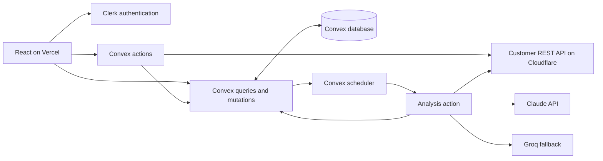
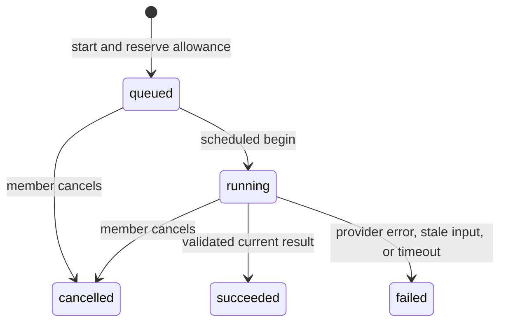

# Architecture

SupportDesk is a single-workspace support demo built with React, TypeScript,
Convex, and Clerk. The frontend is hosted on Vercel; an independent Cloudflare
Worker supplies fictional customer records. This document describes the current
implementation, not a production-readiness certification.

## System boundaries

Clerk establishes identity. Convex checks approved workspace membership on public
data operations. Browser access gates improve the experience but are not the
security boundary. Provider credentials remain in the Convex environment.

## Frontend architecture and state ownership

| Layer                 | Responsibilities                                               | Representative files                                                   |
| --------------------- | -------------------------------------------------------------- | ---------------------------------------------------------------------- |
| Providers and routing | Authenticated Convex client, routes, access boundaries         | `src/main.tsx`, `src/App.tsx`                                          |
| Access gates          | Session and membership loading, sign-in, access-required views | `AuthGate`, `WorkspaceGate`                                            |
| Ticket workflow       | Creation, indexed status filter, pagination, detail lookup     | `TicketListPage`, `TicketDetailPage`, `CreateTicketForm`, `TicketCard` |
| External integration  | Customer selection and explicit detail loading                 | `CustomerPicker`, `CustomerPanel`                                      |
| AI workflow           | Persistent job state, cancellation, results, draft editing     | `AnalysisPanel`, `ReplyDraftEditor`                                    |
| Reusable UI           | Consistent selection behavior and feature styles               | `Select`, shared and component CSS                                     |

Convex owns saved tickets, memberships, jobs, analysis results, draft revisions,
and request counters. React owns unsaved form fields, selected customer, filters,
transient action responses, and pending/error indicators.

`useQuery` and `usePaginatedQuery` subscribe to persisted data. There is no second
Redux/Zustand cache of ticket records to reconcile after writes. This is a scope
decision: a separate client store could become useful for complex cross-page
unsaved state, but is not needed for the current workflow. External customer
action responses are loaded explicitly; they are not reactive subscriptions.

`ReplyDraftEditor` intentionally retains local edits when a newer saved revision
arrives. It warns the user, disables stale saving, and offers an explicit reload.
The backend independently rejects conflicting revisions.

## Data model

Convex supplies `_id` and `_creationTime` on every document.

| Table              | Key fields and purpose                                                                                      | Index           |
| ------------------ | ----------------------------------------------------------------------------------------------------------- | --------------- |
| `tickets`          | Subject, description, status, optional priority and external customer ID                                    | `by_status`     |
| `workspaceMembers` | Approved Clerk user ID                                                                                      | `by_clerk_user` |
| `jobs`             | Ticket/requester, input snapshot, state, timestamps, result, analysis metadata, reviewed draft and revision | `by_ticket`     |
| `analysisUsage`    | Clerk user ID, UTC day, admitted job count                                                                  | `by_member_day` |

New ticket subjects contain 1–120 trimmed characters; descriptions contain
1–5,000. Priority is required on creation but optional in storage for legacy
records; missing priority displays as Medium. Status is `open`, `in_progress`,
or `resolved`. Only the external customer ID is stored on the ticket.

Membership provisioning checks before insertion; an index is not itself a unique
constraint. Identity is derived on the server, not supplied by the browser for
authorization. The current membership key uses Clerk's subject within the one
configured issuer; multiple identity providers would require revisiting that key.

## Queries, mutations, and actions

| Function                                      | Kind              | Responsibility                                    |
| --------------------------------------------- | ----------------- | ------------------------------------------------- |
| `tickets:list`, `tickets:get`                 | Query             | Authorized reactive reads                         |
| `tickets:create`                              | Action            | Validate input and the selected external customer |
| `tickets:insert`                              | Internal mutation | Recheck membership and insert the ticket          |
| `tickets:updateStatus`                        | Mutation          | Validate and persist a status change              |
| `memberships:current`                         | Query             | Return the caller's membership or null            |
| `memberships:addMember`                       | Internal mutation | Provision membership through trusted tooling      |
| `customers:search`, `customers:getForTicket`  | Action            | Authorize and validate REST responses             |
| `jobs:latest`                                 | Query             | Subscribe to the newest ticket job                |
| `jobs:start`, `jobs:cancel`, `jobs:saveDraft` | Mutation          | Admit work, cancel it, or save a revision         |
| `jobs:begin`, `jobs:finish`, `jobs:fail`      | Internal mutation | Apply guarded job transitions                     |
| `jobs:getRunning`                             | Internal query    | Read work that is still active                    |
| `jobs:run`                                    | Internal action   | Retrieve customer context and call AI providers   |

Network calls belong in actions, outside database transactions. Ticket creation
therefore validates a customer in an action before an internal insert mutation.
That remote lookup and insert are not an atomic transaction across services; the
customer could disappear afterward and later lookup must handle that case.

## Filtering, pagination, and routing

Status filtering uses `by_status` before `.paginate()`. Filtering only loaded
React records could miss matches on later pages. `usePaginatedQuery` manages
cursors; changing filter arguments resets the result set. No manual list refetch
is needed after creation or status updates. Reactive page sizes can change.

`/` shows tickets; `/tickets/:ticketId` queries a ticket directly. Invalid or
missing IDs produce a missing-ticket view; unknown routes show page not found.
Vercel rewrites application routes to `index.html` for direct visits and refresh.

## Background analysis and user feedback

1. `start` checks membership and returns an existing queued/running job instead
   of charging another allowance. Otherwise the mutation reserves a daily request,
   saves the input snapshot, and schedules `begin` after one second.
2. `begin` transitions only queued work, schedules the action, and schedules a
   two-minute watchdog. The watchdog changes only work that is still running.
3. The action loads customer context, checks that the job remains active, and
   calls Claude, then Groq if Claude fails.
4. `finish` accepts only a running job and compares current ticket subject,
   description, and customer ID with the snapshot. Changed or removed input fails
   the job instead of publishing an outdated answer. Status changes alone do not
   invalidate analysis.

The UI subscribes to the job, so navigating away or refreshing does not lose its
state. Pending states, errors, cancellation, and manual reruns are visible.
Cancellation prevents a late result from being saved; it does not guarantee that
an already-issued provider request stops or avoids billing. Automatic bounded
retries and exactly-once external execution are not implemented guarantees.

## AI contract and human review

Both adapters request structured JSON and apply the strict Zod contract in
`shared/analysis.ts`: summary up to 1,200 characters, one of four categories,
and a reply draft up to 3,000 characters. Incomplete or invalid responses fail.
Successful analysis records include provider, model, prompt version, and token
usage. Ticket text is serialized separately from system instructions and treated
as untrusted input; this is a mitigation, not a proof against prompt injection.

Only customer name and plan are added to the AI context, not the separate email
field. Ticket text itself may contain personal data; real customer use needs a
data-handling review. The app does not send email or execute suggested refunds.

Saving a reviewed draft compares `expectedRevision` with the stored revision in
a mutation, then increments it and records editor/time. A stale save cannot
silently overwrite another edit. Drafts belong to a job; rerunning analysis makes
a new job and does not merge an older job's reviewed draft into the new one.

## Scope and evidence

See [engineering decisions](engineering-decisions.md),
[verification](verification.md), and [deployment](deployment.md).
The app has one shared workspace with manually approved, equally privileged
members. Multi-workspace isolation needs workspace IDs, scoped indexes and guards.
Separate staging/production, automatic retries, monetary budgets, and full
authenticated browser automation remain future work. No load-test or measured
performance claim is made.
